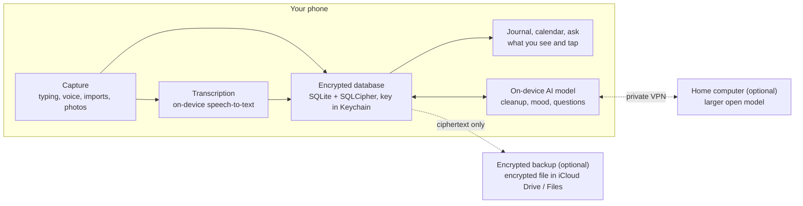

# Private Journal App — Technical Spec

Last updated: 2026-10-21

## Overview and goals

Build a private, single-user journaling app for my own phone, where no journal text, audio or AI output ever leaves the device unencrypted. This document is a build brief: you (the implementing model) should treat the privacy requirements as hard constraints and everything else as strong defaults you may improve on.

**What the app does**

1. Capture an entry by typing or by recording audio.
2. Transcribe audio to text, on the device.
3. Offer a one-tap AI cleanup that removes filler words, false starts and repetition while keeping my meaning, voice and every fact. The original is always kept.
4. Let me ask questions of one entry or many ("key insights this week", "what are my blind spots").
5. Score each entry's mood and show a month calendar coloured by mood, with empty days left blank.
6. Sort every entry into categories automatically.
7. Import my old journals from Notion, Apple Notes, text files and photos of handwritten pages, keeping their original dates.

**Non-goals**

- No other users, no sharing, no social features, no accounts with third parties.
- No App Store or Play Store release. It only needs to run on my phone.
- No analytics, crash reporting or telemetry SDKs of any kind.

**Hard requirements**

- Journal content (text, audio, cleaned text, AI answers, mood scores) is processed on the device by default.
- Anything that is stored off the device is encrypted on the device first, with a key the storage provider never sees.
- The app is locked behind Face ID / fingerprint / passcode.
- I can export everything to a plain file at any time.

## Privacy model

The rule is simple: whoever holds the decryption key, or runs the model, can read the data. So the design keeps both the key and the model on my phone.

**Can Supabase read my data?** By default, technically yes. Supabase encrypts all data at rest with AES-256 and in transit with TLS ([Supabase security](https://supabase.com/security)), but Supabase manages those keys. That protects against a stolen disk, not against the provider, a leaked project key, or a misconfigured access policy. To make Supabase unable to read entries, the app must encrypt each entry on the phone before upload. Supabase then only ever stores unreadable ciphertext.

**Do open-source models keep data private?** Only when they run on hardware I control. An open-weight model (Llama, Qwen, Gemma, Mistral) has no built-in reporting to its maker. But the same model served by a hosted API provider means that provider receives my text. Location matters, not licence. (Note: "OpenCode" is a coding-agent tool, not a model.)

**Do Claude or GPT send data back to the company?** Using them means sending text to that company's servers. For Anthropic's API, prompts are not used for training unless the customer opts in, and are deleted within 30 days by default ([Anthropic](https://www.anthropic.com/uk-government-internal-ai-safety-policy-response/data-input-controls-and-audit)). Consumer chat apps have their own training settings. Either way, a third party holds the text for a time, which this app avoids by running the model on the phone.

| Component | Where it runs | Can it read my entries? |
| --- | --- | --- |
| Transcription | On the phone | No third party |
| Cleanup, mood and Q&A model | On the phone | No third party |
| Local database | On the phone, encrypted, key in Keychain/Keystore | Only me, after unlock |
| Cloud backup (optional) | Passphrase-encrypted file in iCloud Drive / Files | No: ciphertext only |
| iCloud device backup | Excluded: journal files are never included | No: not uploaded |
| Home computer model (optional, deferred) | My own computer, over a private VPN | Only me |

**Threats in scope:** a lost or stolen phone, a cloud provider breach, provider staff access, leaked API keys. **Out of scope:** a fully compromised, jailbroken or rooted phone.

## Architecture

The app is local-first: the phone is the source of truth, and every AI step runs on the phone. Cloud storage is an optional encrypted backup, never required for the app to work.



Everything is processed inside the phone; the two optional (dashed) links carry only encrypted data or go to a computer I own. Both are off by default.

**Target platform: iPhone, native Swift + SwiftUI, deployment target iOS 26.0** (decided 2026-10-21). The phone is an iPhone 15 (iPhone15,4: A16 chip, 6 GB RAM) on iOS 26.6.2. The app isn't tied to that exact version. The Android column below is kept for reference only and is not being built.

| Layer | iPhone (iOS 26+) | Android |
| --- | --- | --- |
| UI | Swift + SwiftUI | Kotlin + Jetpack Compose |
| Transcription | Apple SpeechAnalyzer / SpeechTranscriber, on-device ([Apple WWDC25](https://nonstrict.eu/wwdcindex/wwdc2025/277/)); fallback WhisperKit or whisper.cpp | whisper.cpp with a small or base Whisper model |
| Text model (open-weight) | llama.cpp or MLX running a 3–4B instruct model, 4-bit quantised | llama.cpp running a 3–4B instruct model, 4-bit quantised |
| Text model (alternative) | Apple Foundation Models framework, ~3B on-device model ([MacRumors](https://forums.macrumors.com/threads/apple-announced-foundation-models-framework-for-developers-to-leverage-ai.2458429/)) | — |
| Database | SQLite via GRDB 7.11.1 + SQLCipher 4.19.0 (GRDB copied into `Packages/GRDB` with its documented SQLCipher setup; see `Packages/GRDB/VENDORED.md`) | Room + SQLCipher |
| Key storage | Keychain, Secure Enclave-backed, biometric-gated | Android Keystore, biometric-gated |
| Embeddings (for search) | Small on-device embedding model (e.g. a MiniLM/BGE-class model) via llama.cpp or Core ML | Same, via llama.cpp or ONNX Runtime |

**Model choice.** I prefer an open-weight model. Pick a current 3–4B instruct model from the Llama, Qwen, Gemma or Mistral families at build time, as a GGUF file downloaded once and bundled or stored in app storage. Expect roughly 2–3 GB on disk. Cleanup is an easy task for this size; cross-entry reflection is harder, so see the optional home server below. Apple's Foundation Models framework is acceptable on iPhone as a zero-download alternative: it is not open-weight, but it runs entirely on the device, and Day One already uses it for journaling features ([Pure AI](https://pureai.com/Articles/2025/06/09/Apple-WWDC.aspx)). Put the model behind a `TextModel` protocol so it can be swapped.

**Decided (2026-10-21):** an open-weight model via llama.cpp is the default. Apple Foundation Models may be offered as a switch behind the same `TextModel` protocol, but only on a device that supports it. Known limits of the Apple model: it needs an Apple Intelligence device, has a small (~4k token) context, and its guardrails may refuse sensitive journal content, so a refusal must fall back to the open-weight model or show a clear message, never fail silently.

**The current phone (iPhone 15, non-Pro) does not support Apple Intelligence**, so on it the open-weight model is the only option. It has 6 GB of RAM, shared with iOS, so phase 3 must check that the chosen 3–4B 4-bit model (about 2–2.5 GB) loads and runs without being killed for memory. If it doesn't, drop to a smaller model.

**Chosen model (phase 3, 2026-10-21): Qwen3.5-4B, Q4_K_M quantisation (2.74 GB, Apache 2.0).**
- **Source:** the Unsloth GGUF build (`unsloth/Qwen3.5-4B-GGUF`), pinned to commit `e87f1764…` with SHA-256 `00fe7986…` (full values in `Journal/AI/ModelSpec.swift`). Qwen publishes no official GGUF.
- **Thinking:** Qwen3.5's "thinking" is switched off with an empty think block, so it answers directly.
- **Candidates checked on Hugging Face** for a current 3–4B instruct model:
  - Qwen3.5-4B (March 2026)
  - Ministral 3 3B Instruct 2512 (Mistral's official GGUF, 2.15 GB)
  - Gemma 4 E4B (Google's official QAT GGUF), ruled out at 5.15 GB
  - Llama 3.2 3B, older than the rest
- **Quality check:** both finalists were run on the 10 invented test entries with the real cleanup code (`Tools/cleanup-quality.sh`).
  - **Ministral** rewrote in a formal voice and changed meaning. For example, "I didn't think I'd last two minutes" became "I had expected to struggle for only two minutes".
  - **Qwen** kept 69–71 of 77 must-keep names, numbers and negations (it varies a little between runs at temperature 0.2). Four of the six misses are format changes ("3:15" for "three fifteen", "2 pm", "Dr.", "not looking"). The other two are small slips ("haven't" became "hadn't"; "I don't know" was dropped), which the review screen flags.
- **On the iPhone 15:**

  | Step | Result |
  | --- | --- |
  | Verify checksum | 3.1 s |
  | Load model | 6.4 s |
  | Memory used | About 250 MB (weights are memory-mapped), with 4 GB available under the increased-memory entitlement |
  | Clean one 445-character paragraph | 10 s (about 9 tokens/s) |

**Runtime: llama.cpp release b11457** (2026-10-06), the official prebuilt XCFramework pinned by URL and checksum in `Packages/LlamaCpp`.
- llama.cpp publishes no iOS Simulator slice. So the app links and embeds it only for device builds, using SDK-conditional build settings and a script phase. In the Simulator, the runner is a stand-in that reports "not available".
- The app has the `com.apple.developer.kernel.increased-memory-limit` entitlement.
- The model is freed from memory whenever the app goes to the background.

**Optional home server (deferred: decide after phase 5).** For heavier questions across many entries, the app may call a larger open-weight model running on my own computer (Ollama or llama.cpp server), reached only over a private VPN such as Tailscale. Off by default; the phone model must handle everything on its own. Not built unless chosen after phase 5; keep `TextModel` swappable so it can be added.

**Optional encrypted backup.** Two options were considered. **Decided (2026-10-21): option 1, encrypted file export.** Supabase is not being built and is kept below for reference only.

1. **Encrypted file export** to iCloud Drive / Files. Simplest, no backend.
2. **Supabase** as a blob store. Each entry is serialised to JSON, encrypted on the phone with XChaCha20-Poly1305 (libsodium), and uploaded as one row. The key comes from a passphrase via Argon2id and is stored in the Keychain/Keystore; a recovery phrase is shown once at setup. Enable Row Level Security and never ship the service-role key in the app. Note the free tier pauses projects after 7 days of inactivity ([Jet Admin](https://www.jetadmin.io/blog/supabase-review/)), so the app must tolerate a paused backend and retry later.

**Security baseline.** App lock with biometrics and passcode fallback on every launch and after 1 minute in the background. The fallback is the device passcode (no separate app PIN). Blur the app in the task switcher. Audio files stored with iOS Data Protection "complete". No third-party SDKs, analytics or crash reporters. Network access only for the one-time AI model download from its pinned Hugging Face URL (Wi-Fi only, phase 3), Apple's one-time speech model download through iOS (phase 2), the optional backup and the home server.

**As built in phase 1:**
- The database key is 256 random bits, stored in the Keychain as `WhenUnlockedThisDeviceOnly` with the `.userPresence` access control (Face ID or device passcode). The app never sees the key until you unlock.
- The key is passed to SQLCipher in raw-key form, with no passphrase stretching because it is already random. `.userPresence` is used instead of `.biometryCurrentSet` so that re-enrolling Face ID doesn't lock you out of the journal.
- Unlocking reads the key and opens the database. Locking drops the store, which closes the database.
- The lock screen asks for Face ID straight away at launch and after the background timeout. It doesn't after "Lock now".
- The app-switcher protection is an opaque cover rather than a blur, so nothing shows through.
- Database files use iOS's default file protection. SQLCipher already encrypts them, and the default lets later phases do background work while the phone is locked.
- The lock timeout is fixed at 1 minute in code. It moves into `settings` if it becomes editable.

**Device backups.** Journal data is excluded from iCloud device backups (decided 2026-10-21). The database, audio and attachments live in a directory marked `isExcludedFromBackup`, and the database key is stored in the Keychain as `ThisDeviceOnly`, so it never leaves the phone. The consequence is that until the phase 7 backup exists, a manual export is the only copy off the phone.

## Features

Six features, built in the order listed; importing old journals has its own section below. Each must work with the phone in airplane mode.

### 1. Capture

- New entry screen with a large text area and a record button. I can type, record, or both in one entry.
- Recording: pause/resume, live waveform, elapsed time. Saves as compressed audio (AAC/M4A, mono) in encrypted app storage.
- Entries auto-save every few seconds; nothing is lost if the app closes.
- Each entry has a date (defaults to today, editable for back-dating) and a created timestamp.

### 2. Transcription

- Runs on the phone after recording stops, or live while recording if the platform supports it.
- The transcript is appended to the entry text and stays editable.
- Long recordings (30+ minutes) are processed in chunks with a progress indicator.
- Keep the audio file until I delete it, so I can replay or re-transcribe.

**As built in phase 2 (2026-10-21):**

*Engine and model*
- Transcription uses Apple's SpeechAnalyzer. SpeechTranscriber is used where the device supports it, with DictationTranscriber as the fallback. The locale is the phone's own (en_IE was picked in testing), falling back to en_GB, then en_US. Audio never leaves the phone.
- **Network:** the on-device speech model may need a one-time download through iOS's own asset service (`AssetInventory`). It only starts when I tap Download, either in Settings → Voice or in the prompt shown when I first record. No audio or text is sent. iOS tracks the download per app.
- Apple's engine already drops some fillers ("um") and adds punctuation, so `original_text` is close to verbatim but not exact.

*Recording and storage*
- Transcription runs after recording stops, not live. The recording is saved into the entry first, then transcribed, so a long or interrupted transcription never loses audio.
- A pause of 2.5 seconds or more in speech starts a new paragraph. The transcript is appended after a blank line.
- Each entry has one audio file (`Audio/<entry id>.m4a`). A second recording is added to the end of that file, and only the new part is transcribed.
- "Transcribe recording" in the recording's menu re-runs the whole file and appends the result. "Delete recording" removes the audio and keeps the text.
- Recordings in progress use the protection class "complete unless open", so a recording isn't cut off if the phone locks. Finished audio is switched to "complete".
- The screen stays awake while recording. If the app goes to the background, recording stops and what was recorded is kept. There is no background recording, because the app locks after 1 minute away.

*Interface*
- Long recordings are processed as a stream by SpeechAnalyzer, which reports progress as it goes. No manual chunking is needed. A progress bar shows while it runs.
- An entry that starts as a recording, with no typed text, has `source = audio`. Deleting an entry deletes its audio.

### 3. AI cleanup

- A "Clean up" button produces a tidied version: filler words (um, uh, like, you know, kind of), false starts, repeated phrases and rambling restatements removed; punctuation and paragraphs added.
- It must keep my meaning, first-person voice, tone, every fact, name and feeling. It must not summarise, add insight, soften language or invent anything.
- Show the result as a side-by-side or inline diff against the original. I can accept, edit, or discard.
- Both versions are stored. The entry shows the cleaned version by default with a toggle to the original.
- Long entries are cleaned in paragraph-sized chunks so they fit the small model's context.

**As built in phase 3 (2026-10-21):**

*How cleanup runs*
- "Clean up" sits beside the microphone. It always cleans the **original** text.
- Chunks are whole paragraphs grouped up to about 1,200 characters. Long unbroken transcripts are split at sentence ends.
- Each chunk gets the spec's cleanup prompt (`cleanup-v1`) at temperature 0.2, with a 4,096-token context. A progress panel shows "part N of M" and the text as it streams, with a Cancel button.
- Cleanup is cancelled if the app goes to the background, because iOS doesn't allow GPU work there.

*Reviewing and storing the result*
- The review sheet has three tabs: **Changes** (inline word diff: removed words struck through in red, added words in green), **Cleaned** (editable) and **Original**. Accept or Discard.
- Above the tabs, a "check these" box lists possible lost facts, found by an automatic check:
  - names, using Apple's on-device NaturalLanguage name tagger plus capitalised words
  - numbers
  - fewer negations ("not", "never", "-n't")
- Accepting stores `cleaned_text`, sets `show_cleaned`, and records `ai_version` as `cleanup-v1;<model id>`.
- The entry then has a Cleaned / Original switch, and the switch edits whichever version is shown.
- Cleaning again replaces the cleaned version after a confirmation.
- A new recording's transcript is appended to both versions, still uncleaned, until you clean up again.

*The model download*
- Settings → AI model downloads the model from its pinned URL, over Wi-Fi only (cellular and hotspots are refused), and keeps the screen awake while it runs.
- The file is verified against its SHA-256, and a corrupt file is deleted.
- A model file already present at the expected size, for example one copied in with `devicectl`, is verified the first time it's found.
- The model lives in `Application Support/Models`, excluded from backup.

### 4. Ask the journal

- A chat screen where I ask questions. Scope picker: this entry, a date range (last 7 days, this month, custom), or all entries.
- Example questions: "What are the key insights from this week?", "What are my current blind spots?", "What keeps coming up about work?", "How has my mood changed this month?"
- Retrieval: on save, each entry gets a short summary, themes and an embedding (see Data model). For a date range, feed the summaries for that range to the model. For "all entries", retrieve the most relevant entries by embedding similarity, then answer. If the material exceeds the context window, summarise in batches, then answer from the batch summaries.
- Every answer cites the entries it drew on, as tappable dates.
- Answers can be saved as a "reflection" linked to those entries.

### 5. Mood calendar

- On save (and after cleanup), the model scores the entry: a mood score from −1.0 (very negative) to +1.0 (very positive), a one-word label, and up to three emotions.
- Month view grid. Days with no entry are transparent with a faint outline. Days with entries are filled on a diverging colour scale: muted red (negative) through neutral grey (0) to green (positive). Use a colour-blind-safe palette and show a small legend.
- Several entries on one day: colour by the average score; show a small dot count.
- Tap a day to open its entries. Swipe between months. A one-line monthly summary sits under the grid (entries written, average mood, most frequent emotion).
- I can override any entry's mood by hand; a manual value always wins over the model's.

**As built in phase 4 (2026-10-21):**

*When analysis runs*
- "On save" means once the entry is finished. A background pass analyses entries flagged `needs_analysis`, newest first, one at a time.
- A change to the entry's text sets the flag; a title change doesn't.
- The pass only runs while the app is open and unlocked, the model is ready and **no entry is open in the editor**, so it never competes with typing, recording or cleanup.
- The flag lives in the database, so the pass resumes after a restart. Existing entries were flagged by the v2 migration.
- If the text changed while an analysis was running, that result is thrown away and the entry stays queued.
- A failed entry is skipped until the app restarts.

*How the result is produced*
- The prompt is the spec's, as `analysis-v1`, with one addition for calibration: "0 is neutral, and an entry that is mostly stressed, worried, sad, angry, uneasy or tired is below 0". Without it, the model scored "uneasy" and "tired" entries positive.
- Output is constrained by a llama.cpp GBNF grammar:
  - it is always valid JSON
  - the categories can only be names from the list
  - the score stays within −1…1
  - there's at least one emotion and one theme
- It analyses the cleaned text when there is one. Entries over 6,000 characters are cut to their first 4,000 and last 1,800.
- **Measured:** about 30 s per entry on the iPhone 15, mostly from the length of the JSON output.

*Storing it*
- Each writer saves only its own columns, so the editor's stale copy can never overwrite the AI fields, or the reverse.
- Manual mood and categories are kept when the model runs again. "Let the model…" in the entry hands them back.
- Log entries (`source_kind = log`) get no mood.
- `ai_version` now records each prompt separately, e.g. `analysis-v1@<model>;cleanup-v1@<model>`.

*Calendar and colours*
- The calendar is a Mood tab:
  - The week starts on the phone's first weekday (Monday in Ireland).
  - Days with no entries are outlined. Scored days are filled with the average mood.
  - Days whose entries aren't scored yet have a dashed outline.
  - There's one dot per entry (up to 4) when a day has more than one, and a ring marks today.
  - You can swipe between months, but not past the current one.
  - Tapping a day lists its entries.
- **Palette:** muted red → grey → **teal-green**, rather than pure green. A plain red/green pair failed the colour-blind check (deuteranopia ΔE 3.4); red/teal passes (ΔE about 10).
  - Light mode: `#C4553A` / `#DCDAD5` / `#0F9480`.
  - Dark mode: `#D4664C` / `#4A4945` / `#22A28C`.
  - There are four OKLab-interpolated steps per side, and a legend under the grid.
- The summary line shows the number of entries, the average mood, and the most frequent emotion, but only if one repeats.

### 6. Categories

- Each entry gets one primary category and up to two secondary ones, chosen by the model from my category list, in the same pass as mood (see Prompts).
- Starting list, editable in settings: Work, Relationships, Family, Health, Mind and emotions, Money, Personal growth, Creativity, Travel, Dreams.
- The model may suggest a new category when nothing fits; it is added only after I approve it. This keeps the list small and consistent across hundreds of imported entries.
- I can change any entry's categories by hand; manual choices always win, as with mood.
- The entry list and "Ask the journal" can filter by category ("What patterns show up in my Work entries this year?").
- Editing the category list offers to re-categorise past entries in the background.

**As built in phase 4:**

*Managing the list (Settings → Categories)*
- Add, rename (entries follow), delete (removed from entries too) and reorder. Names are 1–30 letters, digits, spaces and `& ' -`.
- Model suggestions appear under "Suggested by the model" with Add and Dismiss buttons. A dismissed suggestion is kept as `status = dismissed`, so it isn't suggested again.
- After any change, the app offers to re-categorise. That re-queues every entry without manual categories, and the whole analysis runs again.

*In the journal*
- The entry list has a category filter menu. Each row shows a mood dot, the main category and the mood label.
- In an entry, a row shows mood, categories and summary. Tapping it lets you set the mood (slider plus one-word label) or categories by hand, marked with a hand icon.

## Import

Old journals come in through one Import screen, are parsed on the phone, and become normal entries with their original dates. Nothing is uploaded anywhere during import.

**Import screen.** All imports are file-based: there are no API connections or sign-ins to other services. One **Import** button accepts a .zip (including zips inside zips), a folder, or individual files (.md, .txt, .html, .csv, images), also from the share sheet or Files app. The app inspects each file and handles it accordingly: Notion export, Apple Notes export, plain text or Markdown, or images of handwritten pages. A separate **Scan pages** button opens the camera for new photos.

**Pipeline (all sources)**

1. Unpack and parse into candidate entries: title, date, body, attachments, original file path.
2. Show a preview list of every candidate with checkboxes, editable title and date, and flags: no date found, possible duplicate, probably not a journal entry (a shopping list, a recipe).
3. Bulk tools in the preview: filter by folder, select or deselect all, set one date for many, and split one long note into several entries at its date headings (for notes like "Journal 2023").
4. Import the selected candidates. Original text is stored untouched; cleanup is never run automatically on imports.
5. Run a background pass for mood, summary, themes, categories and embeddings, with a progress bar. It must resume if the app closes. Process newest entries first, and prefer running while charging. *(Phase 4 built the resumable, newest-first pass. At about 30 s per entry on the iPhone 15, a 500-entry import takes about 4 hours of the app being open. Phase 6 should look at iOS background processing while charging, and may need a faster or shorter analysis for imports.)*
6. Record each import as a batch, so a whole import can be undone in one tap.

**Dates.** Try these in order and record which one won (`date_source`): a date property or front-matter field; a date in the folder path, title or file name; a date in the first lines of the body; file timestamps, only if a real sample export shows they keep the original note date; otherwise ask me in the preview. Ambiguous numeric dates such as 03/04/2024 default to day-first (I'm in Ireland), with a setting to switch.

**Duplicates.** Hash the normalised body text plus the date. Re-importing the same export skips entries already in the app.

**Folders and file names carry meaning.** Zips contain nested folders, and folder and file names usually mean something, e.g. `Journal/2023/03 March/14 - Rough day.md` or `Notion/Morning Pages/Gratitude.md`. Treat the whole path as metadata:

- Split each path into segments. Strip file extensions and Notion's 32-character IDs.
- Detect dates across the whole path, not just the file name: a `2023` folder, a `03 March` folder and a file starting `14` combine into 2023-03-14. A date property inside the file beats the path; the path beats file timestamps.
- Folder names that aren't dates become candidate categories or tags, such as a `Work` or `Dreams` folder.
- The preview shows the folder tree with an entry count per folder. I can include or exclude whole folders, and give each folder level a role: Category, Tag, Date part (year, month or day), Notebook name, or Ignore. The app guesses and I confirm. Like the column mapping, this is saved per import so re-imports skip it.
- The cleaned file name is the title when the file has none of its own. A file name that is only a date (`2023-03-14.md`) supplies the date and leaves the title blank. Placeholder names (`Untitled`, `New note`, `Untitled 3`) count as no title.
- Files that aren't entries: an image linked from an entry becomes its attachment; a folder of standalone images is offered to the handwritten-page pipeline; a .csv is a database (see column mapping); anything else (.pdf and so on) is skipped and listed in the import summary.
- Keep the original path in `source_ref` so folder roles can be re-applied later without re-importing.

| Source | What arrives | How to parse |
| --- | --- | --- |
| Notion | A .zip, possibly with zips inside, in either export format. HTML export: one .html per page; a database gives one .html table plus a .csv of the same name. Markdown & CSV export: one .md per page; a database gives a .csv plus one .md per row that has content ([Notion help](https://www.notion.com/help/export-your-content)). Images sit in subfolders. A database whose rows have no page content arrives as the table and CSV only, with no per-row files (confirmed in my sample). | Support both HTML and Markdown exports. Recurse folders and nested zips. Strip the 32-character hex ID Notion appends to file names. For databases, read rows from the HTML table when present, since its `<time datetime="…">` attributes give ISO dates; otherwise parse the CSV. Join per-row page files to their rows for the body. Then run property mapping (below). |
| Apple Notes | Markdown files plus attachments, from Export as Markdown in iOS 26 / macOS 26. iOS exports one note at a time; on a Mac, select all notes in a folder and use File → Export As → Markdown ([Bear](https://bear.app/faq/migrate-from-apple-notes/)). | Accept the folder or a zip of it (I'll export on a Mac and AirDrop it). Title = first heading, else file name. Keep linked images as attachments. Exports from older iOS/macOS are out of scope. |
| Text / Markdown | One or many .txt or .md files, or a zip of them. | Read YAML front matter (`title:`, `date:`) when present; otherwise use file name and first line. |
| Photos | Pages from the camera, or images from the photo library. | See below. |

**Notion: what a real export showed.** I tested against a real Notion database export ("Time Log": 491 rows from October 2023 to October 2026). The parser must handle everything below.

- **Files:** `Time Log f91fba08fc7f4b1485d3378ed84f486f.html` and a `.csv` with the same name. There are no per-row files, and row titles link to app.notion.com, not to local files.
- **CSV encoding:** UTF-8 with a byte-order mark. Strip the BOM, or the first column header reads `Name`.
- **Mixed date formats in one column:** `October 29, 2023`, `December 14, 2023 9:30 (GMT)` and `April 10, 2024 11:04 (GMT+1)` (24-hour, with timezone). `Created time` uses a different 12-hour format: `October 29, 2023 8:48 PM`. The HTML `<time datetime="2026-10-20T08:28">` attribute avoids all of this.
- **Backdating is common:** 85 of 491 rows (17%) have a `Date` earlier than `Created time`. Always prefer my own date property over `Created time`.
- **Several rows per day:** 66 days have more than one row, up to 7. Multiple entries on one day must work in the list and the calendar.
- **Gaps:** 7 rows have no title; many columns are mostly empty (`Subtype` is filled in only 9 of 491).

**Getting page contents out of a Notion database.** The sample has no page contents, and its titles link to app.notion.com rather than to files in the zip. That is what Notion produces when row pages are left out. To include them: open the database itself as a full page (not a linked view of it embedded on another page), then choose ••• → Export, select HTML or Markdown & CSV, and turn **Include subpages** on ([Notion help](https://www.notion.com/help/export-your-content)). Success looks like a folder named after the database with one file per row.

If a database's titles link to app.notion.com and no row files exist, the importer warns that the page contents are missing and explains how to re-export, before importing the properties alone.

**Property mapping step (databases only).** Columns differ between databases and can change over time, so no column name is hard-coded. After parsing a database, the app reads whatever columns its header has, guesses each column's role from its values (dates, numbers, short repeated values like a select, long text), shows the columns with sample values, and lets me assign each one a role. The app guesses, and I confirm. The mapping is saved per database name so re-imports skip this step.

| Role | Meaning | Guess from the sample |
| --- | --- | --- |
| Title | Entry title | Name |
| Date | Entry date | Date (preferred over Created time) |
| Body | Entry text | Per-row page content, when it exists |
| Categories | Mapped to my category list, or added as new ones after approval | Project, Type |
| Tags | Stored as themes | Phase, Stage, Subtype |
| Keep as text | Appended to the entry as `Key: value` lines | Duration, Hours |
| Ignore | Dropped | |

The table shows guesses for my Time Log sample only. For every database: unmapped columns are still kept in `source_properties`, so nothing is lost and roles can be changed later; a column that appears in a re-import is asked about; a column that has disappeared is simply ignored. Several date columns may exist, and I pick which one is the entry date.

**Rows with no body.** A database like this one is a log of short items (the average title is 30 characters), not journal text. When most rows have no body, ask how to import it: one short entry per row, one entry per day combining that day's rows as a list, or skip it. Default to one entry per day. Mark these entries `source_kind = log` so they appear on the calendar but are left out of mood scoring unless I opt in.

**Photos of handwritten pages**

- Capture with a document-scanner view (edge detection, perspective correction): VisionKit's document camera on iPhone, ML Kit Document Scanner on Android. Or pick existing photos. Several pages make one entry, in order, and can be reordered.
- Before processing, I enter a title and date. The date field suggests the photo's capture date but stays editable, since I may photograph pages long after writing them.
- Text recognition runs on the phone: Apple Vision text recognition in accurate mode, with `RecognizeDocumentsRequest` on iOS 26 for page layout ([Apple docs](https://developer.apple.com/documentation/vision/recognizedocumentsrequest)); ML Kit text recognition on Android.
- Show each page image beside its recognised text so I can correct mistakes, with low-confidence words highlighted.
- An optional "Fix recognition errors" pass uses the on-device model with a strict prompt (see Prompts). It is separate from the cleanup feature.
- Page images are kept, encrypted, as attachments to the entry.
- Expect messy or cursive handwriting to recognise poorly with built-in engines. If testing shows that, try an on-device vision-language model, or send photos to the optional home-computer model.

## Data model

One encrypted SQLite database on the phone. Six tables; derived AI fields live on the entry so the calendar and search never re-run the model.

**entries**

| Column | Type | Notes |
| --- | --- | --- |
| id | UUID | Primary key |
| title | text, nullable | Imported or typed title |
| entry_date | date | The day the entry belongs to (editable) |
| entry_time | time, nullable | Original time of day when the source has one (e.g. Notion date with time) |
| date_source | text | `typed`, `property`, `title`, `body`, `file`, `photo`, `manual` |
| created_at / updated_at | timestamp | When the row was created in this app |
| source | text | `typed`, `audio`, `notion`, `apple_notes`, `text`, `photo` |
| source_kind | text | `journal` (normal) or `log` (short items from a database with no body text; skipped by mood scoring unless I opt in) |
| source_ref | text, nullable | Original file path inside the import |
| source_properties | JSON, nullable | All original database properties, kept so I can remap later |
| import_batch_id | UUID, nullable | Links to import_batches for one-tap undo |
| original_text | text | What I typed, the raw transcript, or the imported/recognised text |
| cleaned_text | text, nullable | Accepted cleanup output |
| show_cleaned | bool | Which version the entry displays |
| audio_path | text, nullable | Relative path to encrypted audio file |
| audio_duration_s | int, nullable | |
| mood_score | real, nullable | −1.0 to +1.0 |
| mood_label | text, nullable | One word |
| emotions | JSON array | Up to 3 strings |
| mood_manual | bool | True if I set the mood by hand |
| primary_category | text, nullable | From the category list |
| secondary_categories | JSON array | Up to 2 |
| categories_manual | bool | True if I set categories by hand |
| is_journal | bool | Model's guess; used to flag non-journal imports |
| summary | text, nullable | 1–2 sentence model summary, used for range questions |
| themes | JSON array | Up to 5 short tags |
| content_hash | text | Normalised text + date, for duplicate detection |
| embedding | blob, nullable | Vector of the cleaned (or original) text |
| ai_version | text | Model + prompt version that produced the AI fields, so they can be regenerated |

**reflections:** id, created_at, question, answer, scope (`entry` / `range` / `all`), range_start, range_end, cited_entry_ids (JSON array).

**attachments:** id, entry_id, kind (`page_photo` / `image`), file_path (encrypted file), page_order, ocr_text.

**import_batches:** id, created_at, source, file_name, entry_count, property_mapping (JSON; reused when the same database is imported again).

**categories:** name, sort_order, status (`active` / `pending` / `dismissed`), created_at. Edited in settings; model suggestions wait here with status `pending` until approved.

**entries.needs_analysis** (bool, added in phase 4): true when the text changed since mood, summary, themes and categories were last worked out.

**settings:** key, value. Holds lock timeout, chosen model, backup on/off, last backup time.

**Cloud backup row (only if Supabase is used):** id (UUID, same as entry id), updated_at, nonce, ciphertext (bytea), schema_version. No plaintext columns, not even the date, since dates alone reveal patterns.

**Export:** one tap exports a zip through the share sheet, containing `journal.json` (every entry and category) and an `Audio/` folder. Each entry's `audio_path` points at its file inside the zip. The zip is made with the system's own zipping (`NSFileCoordinator` with `.forUploading`), so no library is needed. It is written to the vault's `Export/` folder, which is emptied on every unlock so plaintext copies don't linger. The passphrase-encrypted version is added in phase 7 and reuses the backup encryption.

## Prompts

Starting prompts for the on-device model. Small models follow short, concrete instructions best; use low temperature (0.2) for cleanup and mood, and constrained/JSON output where the runtime supports it. Version every prompt and store the version in `ai_version`.

**Cleanup (run per chunk)**

```
You edit personal journal entries for readability.
Rewrite the text below so it reads cleanly, following these rules:
- Remove filler words (um, uh, like, you know, kind of, sort of, basically, I mean) when they add no meaning.
- Remove false starts and repeated words or phrases. If the same point is made twice, keep the clearest version.
- Fix punctuation and capitalisation. Split into paragraphs where the topic changes.
- Keep the first person, the writer's own words, tone and feelings.
- Keep every fact, name, number, event and emotion. Do not summarise.
- Do not add anything new: no advice, no interpretation, no headings.
Return only the rewritten text.

Text:
<<<{chunk}>>>
```

**Mood, summary, themes and categories (run once per entry, JSON output)**

```
Read this journal entry and return JSON only:
{"mood_score": number from -1.0 (very negative) to 1.0 (very positive); 0 is neutral, and an entry that is mostly stressed, worried, sad, angry, uneasy or tired is below 0,
 "mood_label": one word,
 "emotions": up to 3 single words,
 "summary": one or two sentences in the second person ("You..."),
 "themes": up to 5 short lowercase tags,
 "primary_category": exactly one of [{categories}],
 "secondary_categories": up to 2 of [{categories}],
 "suggested_category": a short new category name only if none fit, else null,
 "is_journal": true if this reads like a personal journal entry, false if it is a list, recipe or reference note}
Base everything only on what the entry says.

Entry:
<<<{text}>>>
```

**Ask the journal**

```
You help me reflect on my own journal. Answer my question using only the entries below.
Be direct and specific. Point out patterns, contradictions and things I may be avoiding when the entries support it.
If the entries do not contain enough to answer, say so.
After each point, cite the entry date in brackets, e.g. [2026-10-14].

Entries (date: text or summary):
{context}

Question: {question}
```

**Fix recognition errors (photo imports only)**

```
This text was recognised from a photo of a handwritten journal page and may contain recognition errors.
Correct only obviously misread words and broken spacing, using context.
Do not rephrase, remove filler, reorder, summarise or add anything. Keep paragraph breaks.
If a word is unreadable, keep it as it is and wrap it in [? ].
Return only the corrected text.

Text:
<<<{ocr_text}>>>
```

**Quality check.** Build a small test set of 10 rambling sample entries (written for testing, not real ones). For cleanup, verify that names, numbers and negations ("didn't", "never") survive. If the chosen model drops facts, try a larger model before rewriting prompts.

*Built:* `JournalTests/Fixtures/cleanup-samples.json` holds the 10 invented entries, each with its must-keep items. `Tools/cleanup-quality.sh <model.gguf>` runs the app's real cleanup code with llama.cpp on a Mac and writes a report. Re-run it whenever the prompt or model changes. Results for the chosen model are under Model choice.

## Installation on my phone only

The app is never published to a store; it is installed directly from my computer.

- **iPhone:** build and install from Xcode on a Mac. With a free Apple ID the install expires after 7 days and must be re-run from Xcode. The paid Apple Developer Program (US$99/year) makes installs last a year and allows TestFlight. Document both in the README.
- Installs are signed with the paid developer team (C8DY3M4VMH), so they last a year. Xcode 26.3 on the build Mac installs fine onto the phone's iOS 26.6.2 (checked 2026-10-21). Step-by-step instructions are in `README.md`.
- **Android (not being built, kept for reference):** build a signed release APK and install it via USB (`adb install`) or by allowing "install unknown apps" for the file manager once. No expiry.
- The model file (2–3 GB) is downloaded once over Wi-Fi on first launch from a pinned URL with a checksum check, or copied in during install. After that the app needs no network. *As built:* the download starts from Settings → AI model, or from the prompt when you first tap Clean up. To copy it in instead, see README.md.

## Build phases and open decisions

Build in seven phases; each ends with something usable on the phone.

1. **Vault:** app lock, encrypted database, typed entries, entry list, export. *(Built 2026-10-21.)*
2. **Voice:** recording and on-device transcription. *(Built 2026-10-21.)*
3. **Cleanup:** model runtime behind `TextModel`, cleanup prompt, diff view. *(Built 2026-10-21.)*
4. **Mood and categories:** mood, summary, themes and categories on save; month calendar; category filter. *(Built 2026-10-21.)*
5. **Ask:** embeddings, retrieval, Q&A screen, saved reflections.
6. **Import:** text/Markdown files first, then Notion, then Apple Notes, then photos with text recognition.
7. **Backup (optional):** encrypted export to a cloud drive, or Supabase blob sync.

**Decisions (2026-10-21)**

- Platform: iPhone, Swift + SwiftUI, iOS 26.0+. (The phone turned out to be an iPhone 15, not a 15 Pro; see Model choice.)
- Model: open-weight via llama.cpp by default. Apple Foundation Models is allowed as an option behind `TextModel` where the device supports it, which the current phone doesn't.
- Backup: passphrase-encrypted file to iCloud Drive / Files (phase 7). No Supabase.
- Home-computer model: deferred; decide after phase 5.
- Categories: keep the suggested ten (editable in settings).
- iCloud device backup: journal data excluded (see Security baseline).
- Phase 1 export: plain JSON; the encrypted export comes in phase 7.

**Open decisions**

- Sample exports: a Notion database export (Time Log) has been provided and analysed above. Still needed before phase 6: a Notion export of a few journal pages that have body text, and an Apple Notes Markdown export of a few non-sensitive notes. They go in `samples/`, which is git-ignored.

**Instructions to the implementing model:** ask me about any open decision still unanswered before starting phase 1. Do not add network calls, SDKs or services beyond those named here without asking. Where this spec names a library or model, verify it is current and suggest a better one if it exists.
